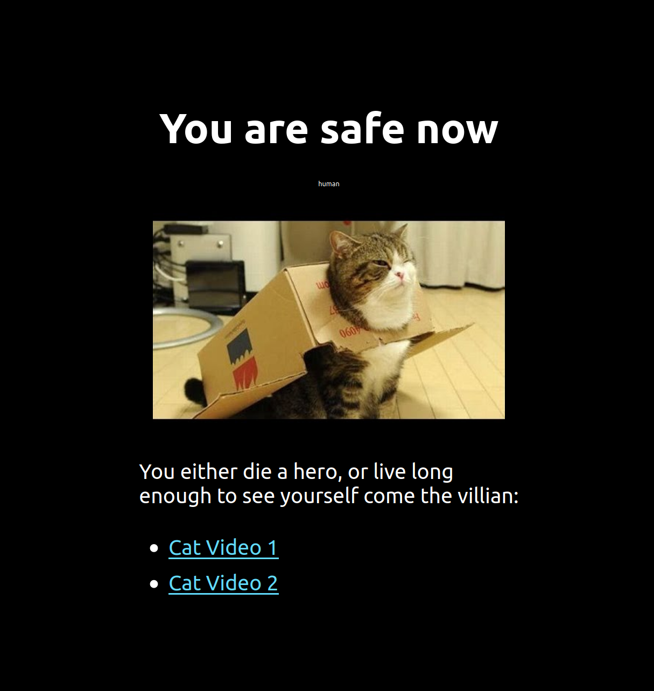
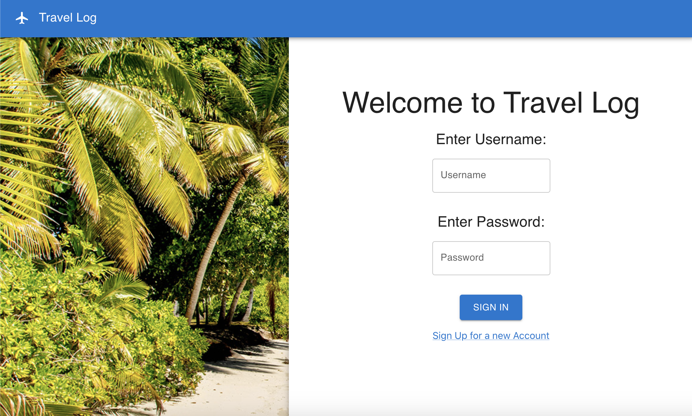

# COMP6080 Tutorial 4

React, UI

## 1. Creating an app (5 mins)
Create a new Vite app in an exercise folder by running npm create vite@latest.

1. select React as the framework
2. select JavaScript as the variant
3. You are free to choose your own project name.
4. cd into that folder then type ls and you should see some files including package.json. 
5. Open the file src/App.tsx in an editor. This is the file we are going to edit for this lab.
6. In your terminal window run npm run dev which will start up the development environment (essentailly a mini deployment that will automatically reload when you make changes to your code).
7. Modify the App.tsx file to change the text Edit src/App.tsx and save to reload with the text Pa-ran-nah!.
8. Once you've done this, replace the current image with any other image you want

## 2. Styling (5 mins)
1. While npm run dev is running, open the file src/App.tsx and src/App.css in an editor. These is the file we are going to edit for this lab.
2. Make your ReactTS app look identical to the page below.


## 3. Clean up a React App - improve accessibility in the context of linting and material ui (15 mins)
In the `exercise` folder run `npm i` and then `npm run dev`.

This contains a *very bad* react app, with a single component, that attempts to display a simple page with a header, footer, and body that has an input and a button.

### Part 1

This code fails to adhere to a number of very basic accessibility and best practices. Implement any and all relevant improvements to the code to make it more accessible.

### Part 2

Play around with the linter. We have already set up ESLint for you which has been configured in `exercise/eslint.config.ts`. Run `npm run lint`. This will lint all React TypeScript files.

Ensure your `exercise` passes the linter.

### Part 3

It's time to try and use a React based library - **Material UI**.

Install Material UI with yarn [here](https://mui.com/getting-started/installation/)

```sh
npm add @mui/material @emotion/react @emotion/styled
```

Once installed, add at least two Material UI components to your ReactTS app. They can be headers, buttons, alerts, cards - anything. They must be clearly visible to someone using the page.

## 4. Get comfortable using a UI framework by using one to build a page (15 mins)
Using only components from the Material UI library try and recreate the following website layout:


- Install the material UI library using the following commands

```sh
npm install @mui/material @emotion/react @emotion/styled
npm install @mui/icons-material @mui/material @emotion/styled @emotion/react
```

- Use material UI components such as AppBar, Box, Paper, Typography, Link and Button to develop your own version of this page.
- For the beach image use the `beach.jpeg` file given in the src folder
- For the plane icon, use the icon available in the Material UI Icon library
- When the _Sign In_ button is clicked console log the message "Welcome to Travelog {username}!"
- If either username or password as empty when _Sign In_ button is pressed, console log the message "Enter username and password"

### Project Initialisation

Create a new Vite app in an `exercise` folder by running `npm create vite@latest`.

- select `React` as the framework
- select `Typescript` as the variant

You are free to choose your own project name.

## 5. Props and Components (15 mins)
Create a component called ProfileCard that displays a person's name and degree.
> props & destructuring props